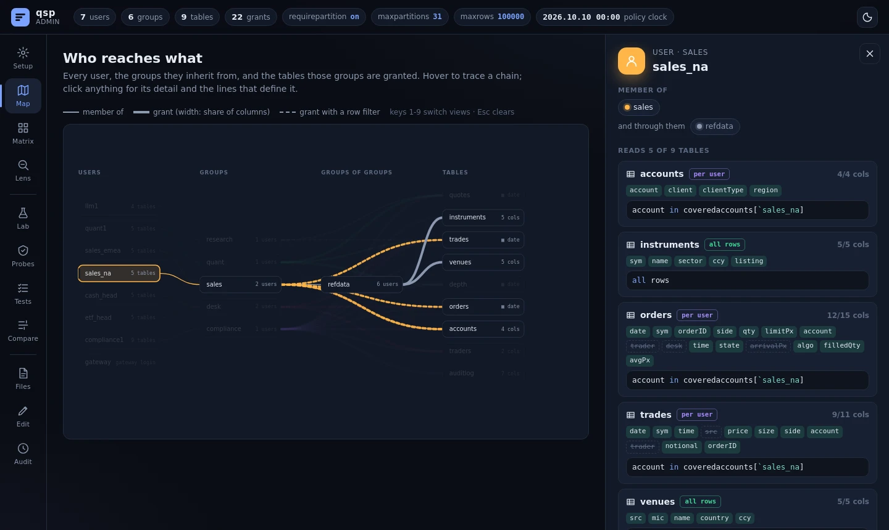
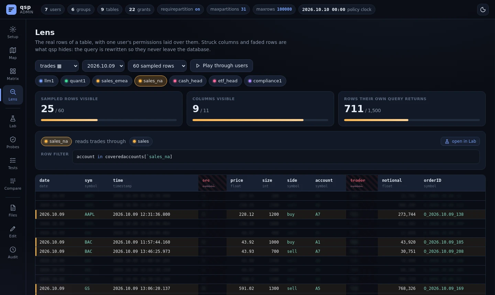
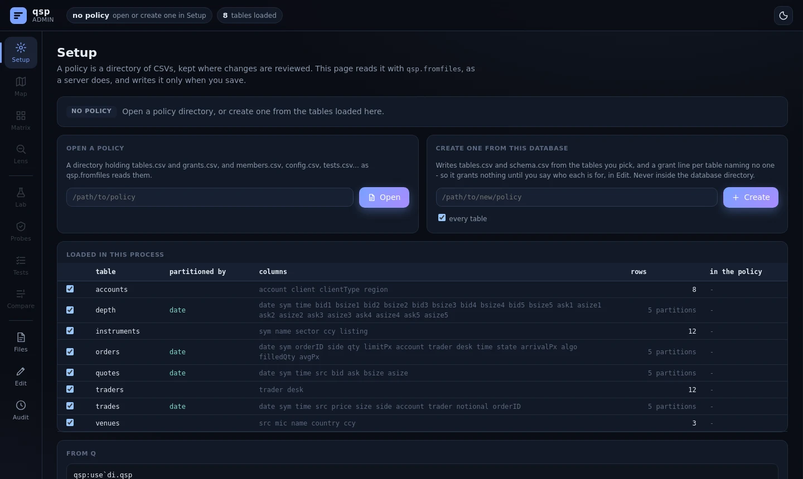
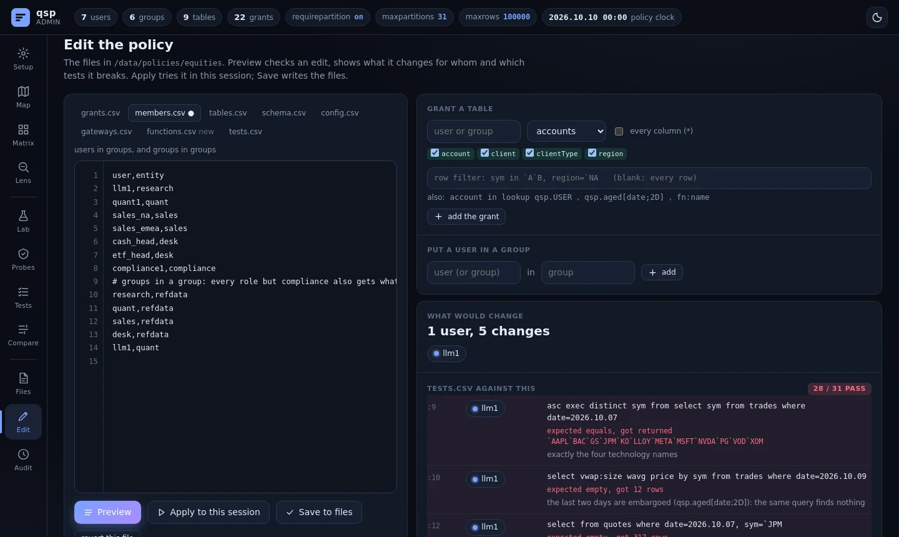
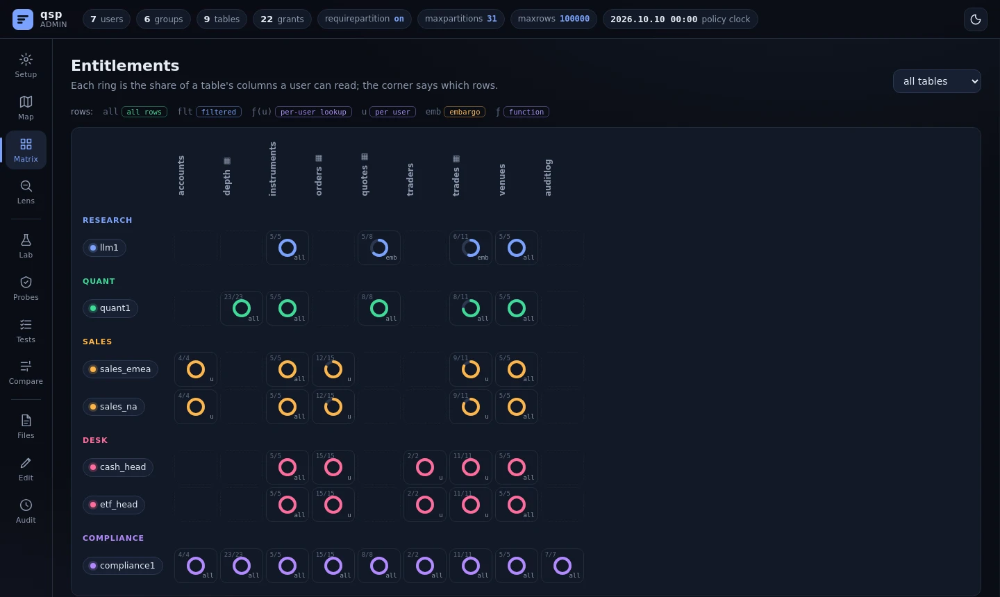
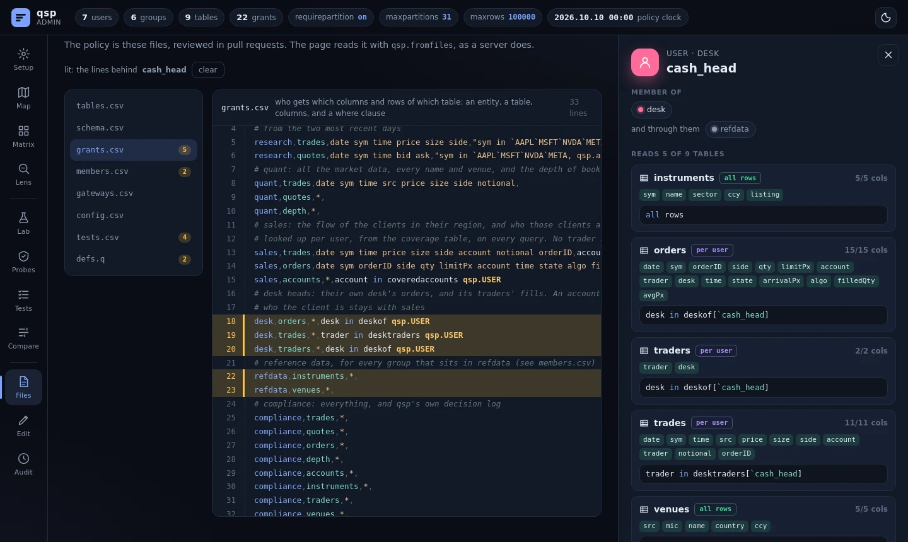
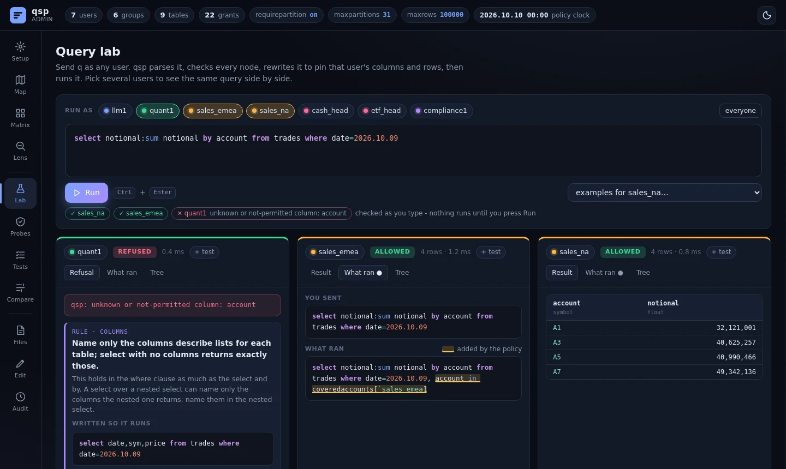
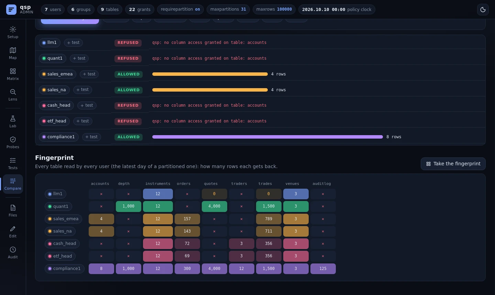
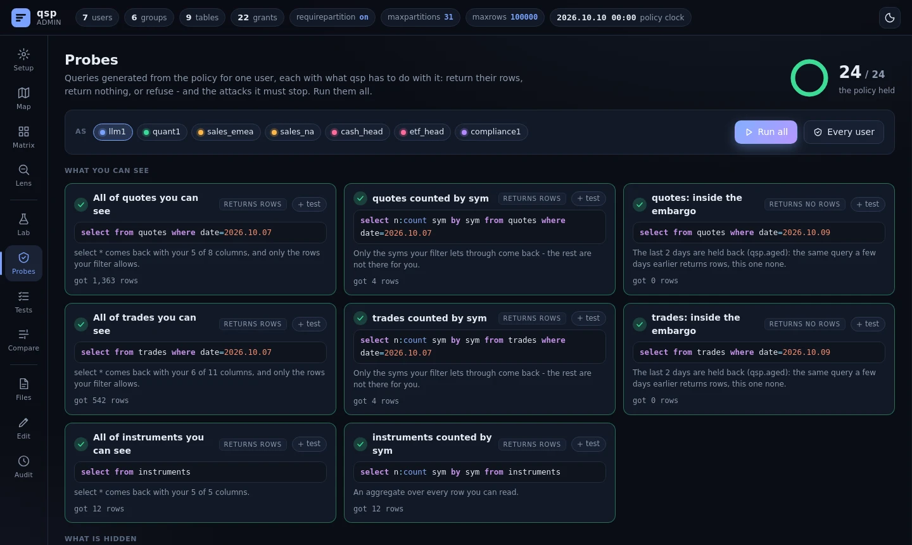
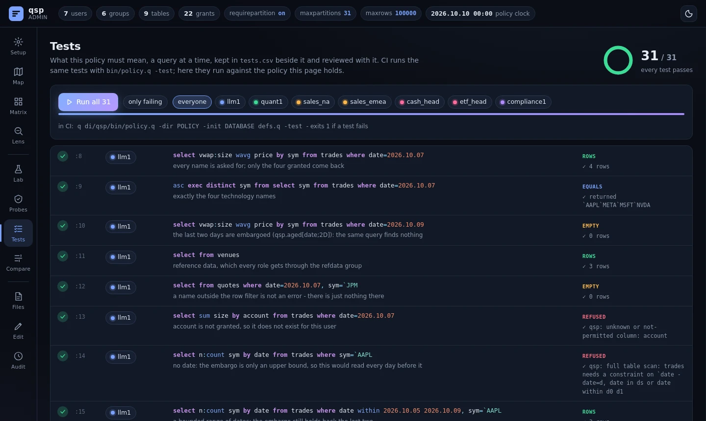

# The admin UI

`qsp.adminui` serves a web page for writing, testing and exploring a policy.
It runs in any q process that has the data loaded, so the people deciding who
can see what can see it happen: the rows a user gets, the query qsp actually
ran, what a change to the files would change for whom, and which of the
policy's tests it would break.



It is for the people who write, review and explain a policy: a permissions
team setting one up, an approver reviewing a change, someone answering "why
can't this user see that". It is not a way to serve a policy. Clients query a
process that calls `qsp.serve`, and the admin UI never runs in one of those
(see [Who can reach it](#who-can-reach-it)).

[../qsp.md](../qsp.md#the-admin-ui) is the reference for `adminui`. This page
is the guide.

## Starting it

In a process with the data loaded (an HDB, an RDB, a database you have just
built):

```q
qsp:use`di.qsp
qsp.adminui`local
```

```
  qsp admin UI   http://localhost:8080/
                 this machine only - qsp.adminui`public to open it to others
  policy         none yet - set one up in the page
```

Open the address. With no policy yet the page starts at
[Setup](#setup-open-or-create-a-policy). To open one straight away, name its
directory:

```q
qsp.adminui ([access:`local;port:8080;dir:"/data/policies/hdb"])
```

| argument | |
|---|---|
| `` `local `` | answer this machine only |
| `` `public `` | answer any machine that can reach the port. Read [Who can reach it](#who-can-reach-it) first |
| `` `stop `` | put `.z.ph` and `.z.pp` back as they were, and close the port if `adminui` opened it |
| `access` | `` `local `` or `` `public `` |
| `port` | the port to open. If the process already listens on one, that port is used. Otherwise 8080, or the next free one up to 8099. `0` installs the handlers without opening a port, for calling them from the process (see [The JSON API](#the-json-api)) |
| `dir` | the policy directory to open |

`adminui` returns the address and prints it, with the policy it opened and
whether it loads. Calling it again changes the access or the policy, keeping
the handlers it installed. Load any q the policy names first (the lookups its
filters call, `fn:` functions, the clock): the page loads the policy the same
way `qsp.fromfiles` does in a server, and a function that isn't defined is a
problem it reports.

The example opens it on its own HDB and policy in one line:

```sh
q di/qsp/examples/equities/demo.q            # then open the address it prints
```

Run the process in the foreground: q exits when its console's input ends.
Under WSL, the `localhost` address works from a Windows browser too.

The page is plain HTML and JavaScript, read from `di/qsp/admin/ui/` on every
request. Nothing is fetched from the internet and there is nothing to build.
Any recent browser will do.

## Who can reach it

The admin UI is an admin tool, and has the powers of one:

- It runs queries as **any user** of the policy.
- The [Lens](#lens) shows a table's **raw rows**, including the ones the
  policy hides.
- [Edit](#edit-change-preview-and-save-the-files) and [Tests](#tests) **write
  the policy's files** when you save.

So:

- **`` `local `` answers this machine only.** A request from any other
  address gets `403 Forbidden`.
- **`` `public `` answers anyone who can reach the port.** It prints the
  machine's address as a reminder. There is no password. To use the page from
  another machine, an SSH tunnel keeps it local:
  `ssh -L 8080:localhost:8080 host`, then open `http://localhost:8080/`.
- **It refuses to start in a process serving a policy.** `qsp.serve` and
  `adminui` in one process would let anyone who reaches the page past the
  policy that process enforces. Run the admin UI in a process of its own.
- **Run it on a copy of the data** where you can: a UAT HDB, or a database
  built for the purpose.

Queries the page runs go through qsp exactly as a client's would, and are
recorded in the audit log ([Audit](#audit)), including the ones it shows for a
test. `qsp.runtests` on its own, as `bin/policy.q -test` uses it, records
nothing.

## The page



- **The header** shows the policy at a glance: users, groups, tables and
  grants, the settings that bound work (`requirepartition`, `maxpartitions`,
  `maxrows`), and the policy clock. Click a setting for what it does. While no
  policy loads, it shows the problem count instead. When an edit has been
  applied to the session but not saved, a banner says so, with **reset** to
  go back to the files.
- **The rail on the left** switches views. The views that need a policy that
  loads are dimmed until there is one. A badge on Tests counts the tests you
  have collected but not saved.
- **The drawer.** Select anything - a user, group, table, column, grant or
  setting - in any view, and a drawer opens on the right with it in full:
  for a user, their groups and every table they read, column by column, with
  the row filter. It ends with **Defined in**: the lines of the policy files
  that define it. Click one to open the file at that line.

| key | does |
|---|---|
| `1` to `9` | switch to the first nine views, in the rail's order |
| `Esc` | close the drawer, and clear the selection |
| `t` | light or dark theme |
| `←` `→` | in the Lens, the previous or next user |
| `Ctrl`+`Enter` | in the Lab, run |

The address bar keeps the view, so a link opens the same view: for example
`http://localhost:8080/#/lens?user=sales_na&table=trades`, or
`#/lab?user=llm1&q=select%20from%20venues`, which runs the query.

## Setup: open or create a policy



Setup says where the policy is and whether it loads, and lists the tables
loaded in the process: their partition column, their columns, and their rows
(or how many partitions).

- **Open a policy** reads a directory the way `qsp.fromfiles` does.
- **Create one from this database** runs `qsp.scaffold` for the tables you
  tick. It writes `tables.csv`, `schema.csv`, `config.csv` with every setting
  at its default, and a grant line per table naming no one. Those lines do not
  load until someone says who each is for, so the new policy grants nothing,
  and the page takes you to Edit to fill them in. It never writes inside the
  database directory.

A policy that does not load shows its problems with their file and line.
Click one to go to it in Edit. The views that need a working policy wait until
it loads.

## Edit: change, preview and save the files



Every file of the policy, as text: `grants.csv`, `members.csv`, `tables.csv`,
`schema.csv`, `config.csv`, `gateways.csv`, `functions.csv` and `tests.csv`. A
file the policy doesn't have yet is marked *new*, and is written only if you
put something in it. A tab shows a dot when the file is changed, and a count
when it has problems.

The forms on the right write a line for you:

- **Grant a table**: who it is for (a user or a group), the table, its
  columns (or every column, `*`), and a row filter as a q where clause.
- **Put a user in a group**, or a group in a group.

Then:

| button | does | writes |
|---|---|---|
| **Preview** | checks the edited files on a copy (`qsp.check`); if they load, shows what changes for whom (`qsp.diff`) and runs the policy's tests against the edit, listing any that break | nothing |
| **Apply to this session** | the same, then uses the edited policy in every view until you reset or save | nothing |
| **Save to files** | writes the changed files to the policy directory, after asking, and loads them again | the changed files |
| **revert this file** | puts the tab back as the files have it | nothing |

Preview is the review a pull request should carry: "llm1 gains depth and
loses the embargo", "three tests break", rather than "members.csv: one line
added". Save writes even if the policy has problems, as a policy is often
written over several sittings: Preview first to see them. The files are the
policy: commit them, and let review and CI ([setup.md](setup.md)) do the
rest.

## Seeing what a policy means

### Map

Users, the groups they inherit from, groups of groups, and the tables those
groups are granted, as a graph. A grant's line is as wide as the share of the
table's columns it grants, and dashed when it has a row filter. Hover over
anything to trace its chain: a user lights their groups and every table they
reach; a table lights everyone who reads it. Click a table to fan out its
columns, with how many users see each one.

### Matrix



Every user against every table. A ring is the share of the table's columns
the user reads, and the corner says which rows: `all`, a filter (`flt`), a
per-user lookup (`ƒ(u)`), a filter on the user's own name (`u`), an embargo
(`emb`), or a filter function (`ƒ`). Pick a table above the grid for users against its
columns instead.

### Lens

A table's real rows, for a day of a partitioned table, sampled evenly through
it, with one user's view laid over them: struck, blurred columns and faded
rows are what qsp hides from that user. Above them are how many of the sampled
rows and columns they see, how many rows their own query of the whole day
returns, and their row filter with the groups it comes through. Switch user
and the view animates; **Play through users** steps through all of them.

The Lens shows the hidden rows to show what is hidden, so it is the one view
that reads data outside the policy. See [Who can reach it](#who-can-reach-it).

### Files



The policy as it is kept: the CSVs, `tests.csv`, and `defs.q` if the policy
directory has one. Select anything and the lines that define it light up, with
a count beside each file: for a user, their memberships, every grant they
inherit, their tests, and the functions in `defs.q` their filters call. Click
a line to select what it defines.

## Trying queries

### Lab



Write q, pick who runs it, and run it (`Ctrl`+`Enter`). Pick several users to
see the same query side by side. As you type, each user's chip says whether
qsp would run it, and why not; nothing runs until you press Run. Each result
has three tabs:

- **Result**: the rows, or for a refusal, the message and the rule it comes
  from - the same rules `qsp.api.rules` gives an LLM agent - with versions of
  the query written so they run. Click one to try it.
- **What ran**: the query you sent, and the query qsp ran, written back as
  q-SQL, with the row filter the policy added marked. On `select *` the
  columns listed are the ones the user was granted.
- **Tree**: the parse tree q evaluated, as `qsp.explain` gives it.

The examples menu has queries worth trying as the first picked user.

### Compare

One query as every user, side by side: each user's row count as a bar, or
their refusal and the rule behind it. The presets are one per table.



**Take the fingerprint** reads every table as every user (the latest day of a
partitioned one) and shows the row counts as a heatmap: the policy's shape on
one screen. Click a cell to open that query in the Lab.

### Probes



Queries generated from the policy for one user, each with what qsp has to do
with it:

- **What you can see**: each table they read, and counted by its filter
  column - only the values their filter allows come back. With an embargo, a
  day inside it, which returns nothing.
- **What is hidden**: a column they were not granted, a table they cannot
  read.
- **Guard rails**: a scan of every partition, a one-sided date range, the row
  index, an update in place.
- **Attacks**: `system`, `value`, handle 0, a function named at run time, a
  lambda, writing a file, a table's name used as a value.

**Run all** runs them as that user; **Every user** runs them for each in
turn. A probe passes when qsp did what it says. Click one to see what came
back and what ran.

## Tests



The policy's `tests.csv`: what the policy must mean, a query at a time. Each
test is a user, a query, and what qsp must do with it - return rows, return
none, run, refuse (with text the refusal contains), or return exactly a value.
[Testing a policy](../qsp.md#testing-a-policy) has the format. CI runs the
same tests with `bin/policy.q -test`, and the page gives the same verdict:
both use `qsp.runtests`.

- **Run all** runs them with a progress bar and a score. Filter to one user,
  or to the failing ones. Click a test for what came back and what ran, or its
  line number to open `tests.csv` there.
- **+ test** on a Lab result, a probe or a Compare row turns what happened
  into a test: rows, no rows, the refusal it got, or the exact value when the
  result is short. They collect at the top of Tests, with a badge on the rail.
  Check what each must do, give it a note, and **Save to tests.csv**: the page
  checks the new lines on a copy first, then appends them.
- [Edit](#edit-change-preview-and-save-the-files)'s Preview runs the tests
  against an edit, so a change that breaks one says so before it is saved.

## Audit

qsp's decision log, live: every query the page or anyone else ran in the
process, who ran it, whether it was allowed, denied, or an error in q, and
why. Filter by decision; new rows flash as they arrive. In the example,
compliance can read the same log as the table `auditlog`.

## Workflows

**Set up a policy for a new database.** Load the database, `qsp.adminui`local`,
then in Setup create a policy in a directory beside it (not inside it). Edit
opens with a problem for each table: the grant lines naming no one. Replace
them using **Grant a table**, add people with **Put a user in a group**,
Preview, and Save. The policy loads; check it in the Map and the Lens, then
collect tests from the Lab and Probes and save them. Commit the directory.

**Review a change before it is merged.** Open the branch's policy directory.
In Edit, Preview shows what the change does for whom and which tests break.
Put that in the pull request beside `bin/policy.q -dir new -was old`
([setup.md](setup.md#8-review-a-change)), which CI can run.

**Answer "why can't this user see that?"** Run their query in the Lab as
them. A refusal names what was refused and the rule behind it; a result with
fewer rows than they expect shows its row filter in **What ran**. The drawer
for the user, or for the user and that table from the Matrix, shows the grant
responsible and the line of `grants.csv` it comes from.

**Pin down an intention.** When someone says "research must never see an
account", run the query that would show one as a research user, check it is
refused, and **+ test** it. Save it, and CI holds the policy to it from then
on.

**Show a policy to someone who doesn't read q.** The Lens with Play through
users, and the Compare fingerprint, show what each person sees without a line
of q.

## The JSON API

The page talks to the process with one call: `POST /api` with
`{"call": name, "args": {...}}`, answered by `{"ok": true, "data": ...}` or
`{"ok": false, "error": "qsp: ..."}`. It is the page's API, and changes with
the page. For an agent or a gateway, [`qsp.api`](../qsp.md#the-api) is the
stable one.

| call | args | does |
|---|---|---|
| `overview` | | everything the page shows: the policy's state, users, groups, grants, tables, access, settings, rules, files with each row's line, tests, and the tables loaded |
| `open` | `dir` | open a policy directory |
| `create` | `dir`, `tables` | scaffold a policy from tables loaded here |
| `preview` | `files` (`{"grants.csv": "text"}`), `apply` | check an edit on a copy: its problems, or what it changes and its tests' results. `apply` uses it for the session |
| `save` | `files` | write files to the policy directory, and open it again |
| `reset` | | back to the policy as the files have it |
| `run` | `user`, `query` | run a query as a user: the result, what ran, the filters the policy added |
| `compare` | `query` | the same query as every user |
| `lens` | `user`, `table`, `date`, `n` | a sample of the table's rows, and which of them and of its columns the user sees |
| `test` | `i` | run the `i`th test (from 0) of `tests.csv` |
| `savetests` | `tests` | append tests to `tests.csv` |
| `describe`, `validate` | `user` (and `query`) | `qsp.api.describe` and `qsp.api.validate` |
| `audit` | `n` | the last `n` decisions |

```sh
curl -s -X POST -d '{"call":"run","args":{"user":"llm1","query":"select from venues"}}' http://localhost:8080/api
```

From the process itself, the handler can be called directly, which is how the
module's tests drive the page:

```q
.j.k last "\r\n\r\n" vs .z.pp enlist "api ",.j.j `call`args!(`run;`user`query!("llm1";"select from venues"))
```

## How it works

`admin/init.q` installs `.z.ph`, which serves the files in `admin/ui/`, and `.z.pp`,
which answers `/api`. It keeps the state of the policy it is editing: its
directory, the policy, whether it loads, and its tests. It runs queries only
through the functions `init.q` lends it when `adminui` is called: `runx`,
`rewrite`, `runtests` and the rest, so every query goes through the same
pipeline a served process uses. The page itself is a set of plain ES modules,
one per view, read from disk on each request: edit one and reload.

It writes only when the page saves: the files Edit saves, and new tests
appended to `tests.csv`. Preview and Apply work on a scratch copy under
`$TMPDIR` (or `/tmp`). [internals.md](internals.md) describes the files.

## When something goes wrong

| what you see | means |
|---|---|
| `403 Forbidden` from the page | the request didn't come from this machine. If it did - a browser on Windows talking to WSL, say - restart with `` `public ``, or use an SSH tunnel |
| `cannot open a port from 8080 to 8099` | every one is taken. Name a port: `qsp.adminui ([access:`local;port:9000])` |
| `this process serves a policy` | the process has called `qsp.serve`. Run the admin UI in another process |
| the views are dimmed | no policy is open, or it does not load. Setup and Edit say why |
| a problem says a function `is not defined in this process` | the policy names q you have not loaded. `\l` it, then reopen the policy |
| the Lens says a table `is not loaded in this process` | the policy describes the table with `schema.csv`, but its data is not here |
| `qsp: nyi` on a partitioned table | q itself does not run `exec`, `select[n]` or a sorted select on a partitioned table. Run it over a nested select: `exec sym from select sym from trades where date=...` |
| the page looks out of date after an upgrade | reload it. Nothing is cached, but an open tab keeps the scripts it loaded |
