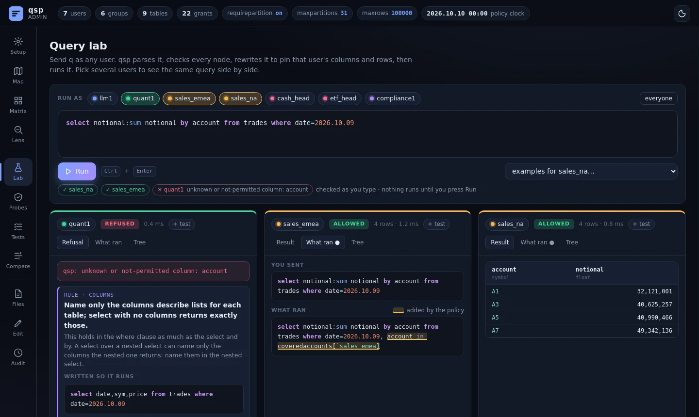
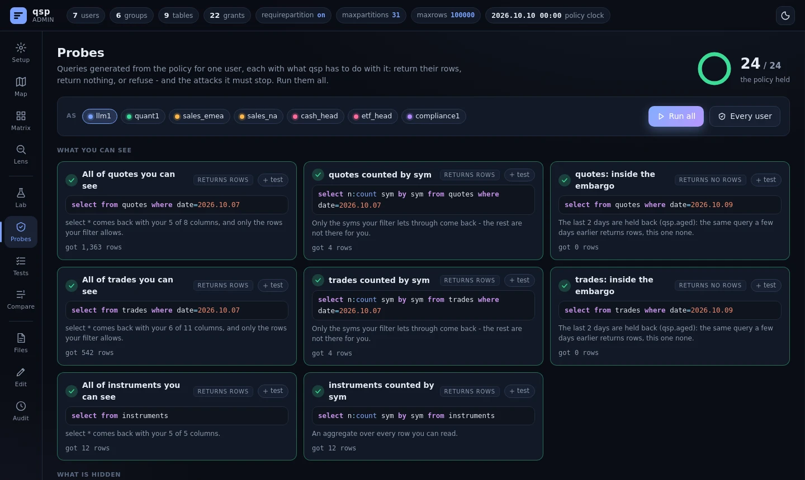

# Example: a policed equities HDB

A small equities execution database, a filled-in policy for it, a walkthrough
of what each role can and can't read, and a page to explore it in.

```sh
q di/qsp/examples/equities/demo.q                         # qsp's admin UI on it: open the address it prints
q di/qsp/examples/equities/hdb.q                          # build, walk through, then exit
q di/qsp/examples/equities/hdb.q -p 5100                  # ...then serve it
q di/qsp/examples/equities/hdb.q -db /path/to/db -p 5100  # build or reuse a database there
```

`q` here is KDB-X. Where kdb+ 4.x is installed as `q` too, run the script with
your KDB-X binary instead (often `x`); kdb+ 4.x stops with a message saying so.

Without `-db`, the database is built in `qsp-example-db` under `$TMPDIR`, or
`/tmp` if that isn't set. It is built once and reused after that. Keep it
outside `di/qsp/`, since the module directory is copied as a unit.

## Files

| file | what it is |
|---|---|
| `mkhdb.q` | Builds the HDB: `trades`, `quotes`, `orders` and `depth` partitioned by date and parted by `sym`, and `accounts`, `instruments`, `traders` and `venues` splayed. Five days, a few thousand rows a day, the same data every run. `q mkhdb.q -db DIR [-days N]` builds one on its own. |
| `policy/*.csv` | The policy, as CSV files: five roles, a reference-data group nested in four of them, seven users and a gateway login. |
| `policy/tests.csv` | What the policy must mean, a query at a time: 31 tests, each with what qsp must do. `hdb.q` walks through them, `bin/policy.q -test` runs them for CI, and the admin UI's Tests view runs them live. |
| `policy/defs.q` | The q the policy names: the lookups its filters call, and its clock. It sits with the CSVs so a change to it is reviewed with the grants that call it. |
| `setup.q` | What `hdb.q` and `demo.q` share: builds the HDB if `-db` doesn't exist, then loads it, `policy/defs.q` and the policy. |
| `demo.q` | Opens qsp's admin UI (`qsp.adminui`) on the example, below. |
| `hdb.q` | Builds the HDB if `-db` doesn't exist, then loads it, `policy/defs.q` and the policy. It prints who can read what and walks through `policy/tests.csv`, showing what each query returns. It exits 1 if any test fails, so it is also a test. |

## The admin UI

```sh
q di/qsp/examples/equities/demo.q [-db DIR] [-policy DIR] [-port 8080] [-public]
```

It builds the database if it isn't there, loads it and the policy, and opens
qsp's admin UI on them (`qsp.adminui`; [docs/ui.md](../../docs/ui.md) is its
guide), printing the address. Run it in the
foreground: q exits when its console's input ends. Under WSL, the `localhost`
address works from a Windows browser too. `-policy DIR` opens another copy of
the policy, so you can edit and save without touching this one. `q demo.q
-check` calls each of the page's endpoints, checks the answers, and exits 1 if
one fails, for CI.

Things to try: in Lens, play through the users on `trades`; in Lab, run
`select notional:sum notional by account from trades where date=2026.10.09` as
`sales_na`, `sales_emea`, `quant1` and `compliance1` side by side; in Tests,
run all 31; in Edit, add `llm1,quant` to `members.csv` and preview it - three
tests break.





## The roles

| role | users | can read |
|---|---|---|
| research | `llm1` | trades and quotes for four technology names: price, size and side, no account, trader or venue, and nothing from the two most recent days (`qsp.aged[date;2D]`) |
| quant | `quant1` | all market data, every name, including depth of book. No account or trader |
| sales | `sales_na`, `sales_emea` | their region's clients: those accounts' trades, orders and client details. No trader |
| desk | `cash_head`, `etf_head` | their own desk's orders, its traders' fills, and its traders |
| compliance | `compliance1` | everything, including qsp's audit log |

Every role but compliance is also in `refdata`, which grants `instruments`
and `venues`.

The sales and desk filters call functions defined in `policy/defs.q`
(`coveredaccounts`, `deskof`, `desktraders`). Those functions look the user
up in two small tables, `coverage` and `deskheads`, on every query. Change a
row in one of those tables and that user's next query sees the change, with
no reload.

The data is fixed in October 2026, so `defs.q` also fixes the policy clock
(`clock,fn:exampleclock` in `config.csv`) at the morning after the last day.
Against the real clock every row would be old, and the embargo would hold
nothing back. This is for the demo only: a real policy leaves the clock
alone, so delete both lines before you reuse this policy.

## Loading it in your own process

`qsp.fromfiles` reads only the CSVs. It never loads q, so load `defs.q`
yourself first. Load the database before it, since the lookups read
`accounts` and `traders`:

```q
\l /path/to/qsp-example-db
\l /path/to/di/qsp/examples/equities/policy/defs.q
qsp:use`di.qsp
qsp.serve qsp.fromfiles "/path/to/di/qsp/examples/equities/policy"
```

Or copy `defs.q` into the database root: `\l` on a database also loads the
`.q` files in it. If you do this, treat the copy as a deployment step from
the reviewed policy directory. Anyone who can write to the database could
otherwise change what every filter returns.

CI checks the policy without the data, from `schema.csv`, with the same
definitions:

```sh
q di/qsp/bin/policy.q -dir di/qsp/examples/equities/policy -init di/qsp/examples/equities/policy/defs.q
```

With `-p`, connect as any user in `policy/members.csv`, or log in as
`gateway` and send `` (`.qsp.execas;query;user) ``. The console isn't
policed: try `qsp.run[p;`llm1;"..."]` and `qsp.explain[p;`llm1;"..."]`
there. `qsp.active[]` returns nothing until `qsp.serve` has been called.

## Queries that surprise people

| query | what happens | write instead |
|---|---|---|
| `select[100] from trades where date=2026.10.09` | `'nyi`. q itself doesn't support `select[n]` on a partitioned table. | `100 sublist select from trades where date=2026.10.09` |
| `select from trades where date=last date` | refused: `full table scan: trades needs a constraint on `date - date=d, date in ds or date within d0 d1`. `requirepartition` is on, and qsp can only tell a constraint prunes partitions if it compares the date with a value that names no column. | a literal date: `where date=2026.10.09` |
| `select from trades where sym=`AAPL` (as `quant1`) | refused for the same reason. It would read every partition. | add `date=...` or `date within ...` |
| `select from trades where sym=`AAPL` (as `llm1`) | refused for the same reason. The research embargo is a date constraint, but only an upper bound: it would read every day before the cutoff. | add `date=...` or `date within ...`. The embargo still applies |
| `select from trades where date>2026.10.01` | refused for the same reason. A one-sided range reads every partition on one side of it, and so does `date>=a, date<=b`: q narrows the partitions it reads by the first constraint only. | `date within 2026.10.01 2026.10.09` |
| `select n:count i by sym from quotes where date=...` | refused: `i` is off unless the policy sets `rowindex`. | `count sym` |

`qsp.explain` shows what would run, but it stops before the partition check.
Use `qsp.fullscans[p;user;query]` to see which tables a query would read in
full.

## Starting your own policy from this one

Copy `policy/` to where your team keeps its policies, delete the clock row
from `config.csv` and `exampleclock` from `defs.q`, and follow
[setup.md](../../docs/setup.md).
