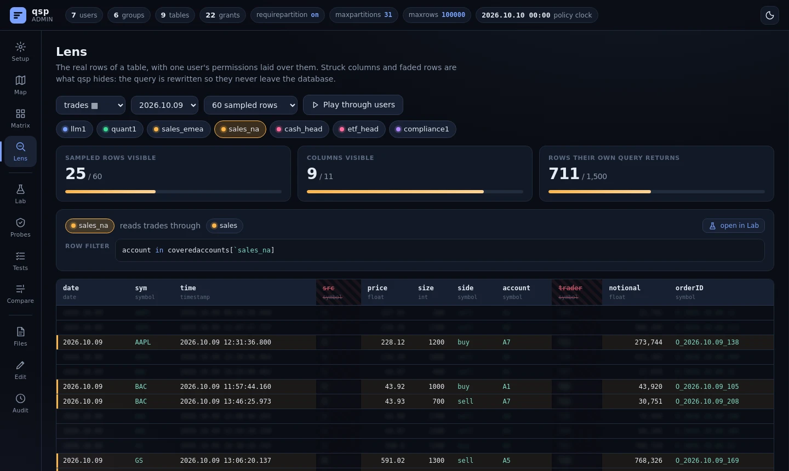
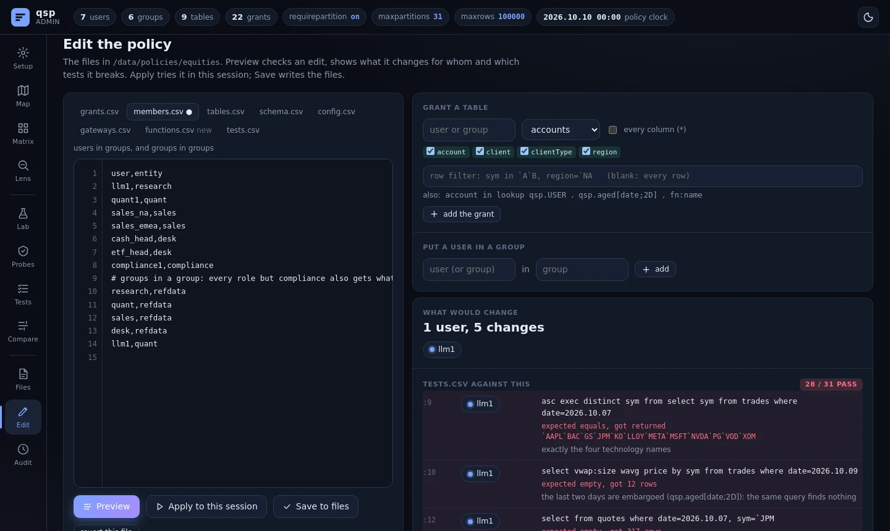

# di.qsp — qSQL security policy, as a KDB-X module

Row- and column-level permissioning for q written by something you do not
trust: an LLM, a notebook, a reporting tool.

A query is **parsed, never evaluated**, and every node of its parse tree must be
explicitly permitted. The tree is then **rewritten** to pin the caller's row
filter and column projection before it runs. Anything qsp does not understand is
refused, so q syntax it has never seen fails closed.

```q
qsp:use`di.qsp

p:qsp.policy[]
p:qsp.table[p;`trade;::]                                     / read its meta
p:qsp.grant[p;`llm;`trade;`date`sym`size;enlist qsp.f.isin[`account;`A1`A2]]
p:qsp.member[p;`alice;`llm]

qsp.run[p;`alice;"select sum size by sym from trade"]        / A1/A2 rows only
qsp.run[p;`alice;"select pnl from trade"]                    / 'qsp: unknown or not-permitted column: pnl
qsp.explain[p;`alice;"select from trade"]                    / what would actually run

qsp.serve p                                                  / police every IPC query
```

A team setting up permissions keeps the policy as CSV files instead. They
edit it in a spreadsheet, review it in a pull request, and check it in CI,
with tests of what it must mean. **[docs/setup.md](docs/setup.md)** walks through it
from an empty process. The **admin UI** (`qsp.adminui`local`) does the same
in a browser, and shows what a policy means: the rows each user gets, what a
change changes for whom, which tests it breaks
([docs/ui.md](docs/ui.md)).

This page is the **reference**: every rule, setting and call is stated here,
once. The other pages explain and walk through, and link here for the rules.
More documentation is in [docs/](docs/README.md):
- **[docs/concepts.md](docs/concepts.md)**: what a policy is made of (users,
  groups, grants, filters, gateways) and how one user's access is worked out.
- **[docs/time.md](docs/time.md)**: embargoes, delayed data and the policy
  clock.
- **[docs/ui.md](docs/ui.md)**: the admin UI, view by view, and the jobs it
  does: setting a policy up, reviewing a change, building its tests.
- **[docs/internals.md](docs/internals.md)**: for developers changing qsp.
  What every file does, and one query traced step by step through the code.
  [docs/testing.md](docs/testing.md) covers qsp's own tests, and
  [docs/history.md](docs/history.md) what changed from the original qsp.

## Try it

[examples/equities/](examples/equities/README.md) builds a small equities
HDB, loads a filled-in policy for it with its tests, and shows what each role
can and can't read:

```sh
q di/qsp/examples/equities/demo.q           # the admin UI on it: open the address it prints
q di/qsp/examples/equities/hdb.q            # walk through its tests, then exit
q di/qsp/examples/equities/hdb.q -p 5100    # ...then serve it
```

Its [README](examples/equities/README.md) describes the roles, how to load the
policy in a process of your own, and the queries that surprise people, such as
`select[n]` on a partitioned table.

## Install

The module is the `di/qsp/` directory, laid out as in
[kdbx-modules](https://github.com/DataIntellectTech/kdbx-modules). Put the
directory holding `di/` on the module search path:

```sh
export QPATH=${QPATH}:/path/to/qsp-mod        # then: qsp:use`di.qsp
```

The submodules reference each other relatively, so the directory can be
copied into a kdbx-modules checkout unchanged.

No dependencies beyond KDB-X. The tests use `di.k4unit` from kdbx-modules.
`qsp.version` is the contents of `VERSION`.

## How it works

### The objects, and what each controls

Everything qsp decides comes from a **policy**: a plain q dictionary that you
build with the functions below, or load from CSV files. qsp never keeps a policy
in globals. You pass one to `run`, or install one with `serve`.

| Policy key | Shape | Controls |
|---|---|---|
| `tabs` | table → partition column | Which tables a query may read. Any other table is refused as unknown. The partition column decides where the row filter goes and what `requirepartition` asks for. |
| `schema` | `([]tbl;col;typ;att)` | The columns each table has. `qsp.ALL` grants all of them. A filter may name only these, and with `strictcolumns` off a where clause may too. The types give `f.aged` its cutoff type, and the attributes rank constraints. |
| `grants` | `([]entity;tbl;columns;rows)` | Which columns and rows of a table each user or group may read. `rows` is `()`, a list of constraints, or a lambda called with the user. |
| `members` | `([]user;entity)` | Which groups a user is in. Groups can contain groups. |
| `fns` | name → function value | The whitelist: every function a query may apply. It starts from `fns.defaults`. |
| `calls` | symbols | Your own functions, which a query may call by name. |
| `joincalls` | symbols | The subset that may stand where a table would, like a join. |
| `gateways` | symbols | Logins that may run a query as another user. |
| `config` | dictionary | The settings, as listed under [Configuration](#configuration). |

Three more things belong to the running module, not to a policy:

| Object | Read with | Controls |
|---|---|---|
| the served policy | `qsp.active[]` | The policy every IPC query is checked against. `qsp.serve p` replaces it in one assignment. |
| the message handlers | `.z.pw` `.z.pg` `.z.ps` `.z.pi` `.z.ph` `.z.pp` `.z.pm` `.z.ws` | Set by the first `serve`, which keeps what was there and runs it; `unserve` puts it back. See [Serving it](#serving-it). |
| the audit log | `qsp.audit[]`, `qsp.audittable[]` | Every decision `run` took, kept in a global table. `auditto` names that global. |

### Who a query runs as

| Entry point | The user is |
|---|---|
| `qsp.run[p;u;q]` / `runx` in your own code | `u`, as you pass it |
| a sync or async IPC message to a served process | `.z.u`, the login |
| `` (`.qsp.execas;q;u) `` from a login in `gateways` | `u`, named by the gateway |
| the process's own console (`.z.w=0`) | nobody: it is evaluated unchecked |

A gateway message from a login not listed in `gateways` is treated as an
ordinary query, and refused. Whichever way it arrives, a query runs only as a
**user of the policy**: a name in `members` or `grants` that isn't a group
(see [Logins](#logins)). `qsp.run[p;`nobody;"1+1"]` is refused with
`qsp: not a user of this policy: `nobody`, though it reads no table. So is a
group's name, a list of names (their grants would union) and anything that
isn't one symbol. The refusal is recorded as `denied`.

qsp takes the login name as given. It **authorises** (given who you are, what
you may see) but does not **authenticate** (prove who you are). See
[Logins](#logins).

### What happens to a query

`run` takes a policy, a user and a query, which is a string or a parse tree. It
passes the query through a fixed sequence of steps. The first step that refuses
it stops it, records the decision in the audit log, and signals `'qsp: ...`:

| Step | What happens | A refusal is recorded as |
|---|---|---|
| 1. check the policy | Anything that is not a policy dictionary is refused. | not recorded: there is no policy to record under |
| 2. parse | A string is parsed with `parse`, never `value`. Text that is not q stops here, with q's error. | `error` |
| 3. file handles | A symbol starting with `:` anywhere in the tree is refused. Every filesystem primitive needs one. | `denied` |
| 4. walk and rewrite | Every node of the tree is checked against the policy and the user's grants, and each select is rewritten to read only what the user may see. See below. | `denied`, or `error` for a fault |
| 5. partition checks | With `requirepartition` on, a query that would read every partition of a table is refused, naming the table and column. Leading constraints that compare the partition column with literal data, such as the user's range and an embargo's cutoff, are then merged into one list of partitions, so q reads only the partitions both allow. With `maxpartitions` set, a query that would read more partitions than that is refused. | `denied` |
| 6. evaluate | Only the rewritten tree is evaluated. If q signals, this is where. | `error` |
| 7. bound the result | The result is checked against `maxsize` (serialised bytes) and `maxrows`. | `denied` |
| 8. record | `allowed`, with the rewritten tree. | |

[docs/internals.md](docs/internals.md#what-happens-to-a-query-step-by-step)
follows one query through these steps in the code, function by function,
with the parse tree at each stage.

The other entry points stop part way. `rewrite` and `explain` run steps 1 to
4 and return the rewritten tree, or its text; they evaluate nothing, so they
don't apply the partition checks (`fullscans` lists the tables a query would
scan). `validate` runs steps 1 to 5 and returns `(allowed;reason)`, refusing
with the message `run` would give. It records nothing, and evaluates only the
value of a leading partition constraint, which `maxpartitions` counts. The
result limits in step 7, and checks on values the query computes, need it to
run. `runx` runs every step, and also returns what ran, as text.

A **fault** is a step-4 refusal that withholds nothing. The user holds the
column, but an inner select did not carry it through
(`select price from select sym from trade`). It is recorded as an `error`
rather than a `denied`, so the log never shows an entitled user being denied
something.

### What the user can see

The grants are resolved per user, per table, every time a query is rewritten:

1. **Entities.** The user, every group they are in, and every group those
   groups are in. A cycle is harmless.
2. **Columns.** The union of every column the entities are granted on the
   table, in schema order. `qsp.ALL` is every column in `schema`.
3. **Rows.** Each grant's filter is a list of constraints, ANDed, or a
   function, called with the user here (see [Row filters](#row-filters) for
   what it may return). The grants' filters are then ORed, and one grant with
   no filter means all rows. A filter that fails refuses the query. It never
   falls back to no filter.
4. **Markers.** `qsp.USER` becomes the user as a symbol literal. `qsp.NOW`
   becomes the clock's timestamp, and `f.aged` becomes a cutoff cast to its
   column's type. The tree that runs therefore holds only literals, and the
   audit log shows the values applied.

`qsp.columnsfor[p;u;t]` and `qsp.filterfor[p;u;t]` return steps 2 and 4 for
one table. `qsp.access` returns them for every table, with the filter written
back as a where clause.

### What the rewrite does to a select

The walker visits every node of the tree. A select, exec, update or delete is
taken apart slot by slot:

| Slot | Checked against | Rewritten to |
|---|---|---|
| table | A registered table, which the user must hold at least one column of. Or an expression, walked with no names in scope, that projects columns the select can name (see below). | Unchanged for a select. An update or delete is moved onto `select <granted columns> from t where <row filter>`, so it never writes the real table. |
| where | The user's own constraints, which may name only granted columns. With `strictcolumns` off, they may name any column of the table. | The policy's row filter merged in, ordered as described in [Where the row filter goes](#where-the-row-filter-goes). |
| by | The granted columns (plus `i` with `rowindex` on). | Unchanged. |
| select | The granted columns (plus `i` with `rowindex` on). | `select *` becomes an explicit list of the granted columns. |
| limit, `select[n]` | No column names at all. | Unchanged. |
| sort, `select[>c]` | The granted columns without a `by`. With a `by`, the columns the select returns, because that is what q sorts. | The grade swapped for a guarded `iasc`/`idesc`. |

For a select over a table expression, the "granted columns" are the columns
that expression projects. Every expression in every slot is also walked by
the node rules below, so `not` is guarded wherever it appears.

**Functional forms.** Each clause must have the shape `parse` gives select
text. A functional form whose arguments are plain data parses to exactly that,
and runs: `?[trade;();0b;()]` is `select from trade`. One whose arguments are
code that builds a clause is refused:

```
q)qsp.run[p;`llmu;"?[trade;();0b;(enlist`x)!enlist(sum;`pnl)]"]
'qsp: write the query as select, exec, update or delete - a functional form's clauses must be data, not code that builds them
```

`parse` leaves those arguments as code, `(!;(enlist;,`x);...)`, which q runs
before `?` sees the result. The walker checks clauses as written, so it would
check the code and q would run whatever the code built. Write the query as
select text.

The other nodes are checked like this:

| Node | Rule |
|---|---|
| function value (`sum`, `lj`, `+`) | on the whitelist, matched by identity. `not` is swapped for a guarded version |
| symbol atom | a **name**: it must be a column in scope here. A table name is refused anywhere but a table slot |
| symbol vector of 2+ | q evaluates `` `f`a`b `` as a call, so it must be in `calls`, and its arguments are walked |
| general list | an application: the head must be permitted, and the arguments are walked. A symbol q could resolve as a global is checked (see [Symbols computed at run time](#symbols-computed-at-run-time)) |
| `()` or a one-item list | literal data: `eval` hands back a one-item list's item unevaluated. It may not hold a table name or a function, which q could then apply unchecked |
| lambda, projection, dictionary | refused |
| anything else | literal data |

A table expression is walked before any column is bound, so nothing in it
can name a column. The select above it may name only the columns the
expression is known to project:

| Head | Projects |
|---|---|
| a nested select | its own output columns |
| `lj` `ij` `uj` `pj` `ej` `aj` `aj0` `wj` `wj1`, a `joincall` | every column of their table arguments |
| `` `a`b# `` / `` `a`b_ `` | those columns, or the rest |
| `n#`, `xasc` `xdesc` `xcols` `asc` `desc` `reverse` `distinct` `ungroup` `sublist` `!` | their input's columns |
| anything else (`xcol`, `meta`, `cross`, `,`, a `call`) | nothing, so a select over it is refused |

A projected name that matches a global the user was not granted, such as a
process function, is dropped. A query therefore cannot alias a column to a
function's name and then call that function.

Here is one query, as written and as it runs for a user granted
`date sym account size price` on accounts `A1` and `A2`:

```q
q)qsp.explain[P;`llmu;"select sum size by sym from trade where size>15"]
"(?;`trade;,((in;`account;,`A1`A2);(>;`size;15));(,`sym)!,`sym;(,`size)!,(sum;`size))"
q)qsp.explain[P;`llmu;"select from trade"]
"(?;`trade;,,(in;`account;,`A1`A2);0b;`date`sym`account`size`price!`date`sym`account`size`price)"
```

### Where the row filter goes

q applies constraints left to right. If a user constraint ran before the policy
filter, `where size=max size` would be computed over hidden rows, and an empty
answer would reveal that the largest trade is hidden. If the partition
constraint does not lead, every partition is read. qsp moves only constraints
that **cannot aggregate**: a plain comparison of a column with something that
names no column of the table, or an and, or or `not` of such comparisons
(`qsp.f.notin`, `f.both`, `f.either`, and the OR of a user's two filtered
groups). Two comparisons depend on other rows after all, and stay put:

- `~` matches the whole column and returns one boolean. Run before the row
  filter, `where s~`a`b`zz` would say whether a hidden row's `s` is `` `zz ``.
- a comparison with a list (`where s=`a`b`a`) compares row by row, and
  signals `'length` unless the list is as long as the rows in front of it.
  Run before the row filter, that counts the hidden rows. So `=`, `<`, `>` and
  their negations move only with one value on the right, `within` with two
  and `like` with one pattern; a value the user computes is checked as it
  runs, and refused if it is a list: `qsp: a comparison in a where clause
  takes one value - use in for a list`.

It ranks the movable constraints partition column first (a
constraint that bounds it, such as `date=d` or `date within ...`, ahead of a
one-sided range such as an embargo), then indexed columns (by attribute and operator), then the policy filter, then the
rest. Anything that could aggregate keeps its place, after the policy filter.
A policy filter that could itself aggregate goes before everything the user
wrote.

```
select sum size by sym from trade where size>50, sym=`600, date=2010.01.05
  -> date=2010.01.05, sym=`600, account in ..., size>50
```

`placement` overrides this. `` `first `` puts the policy filter first and
leaves the user's order alone, and `` `last `` puts it last. `` `last `` is the
fastest, and it permits exactly the inference described above.

When the policy filter has to lead - `` `first ``, or a filter that could
aggregate - q reads every partition whatever the user writes, because it
prunes by the first constraint only. With `requirepartition` on, such a table
cannot be queried at all, and the refusal says so rather than asking for a
date the query already has.

### What is never allowed

These can't be whitelisted, whatever a policy says: `value`, `get`, `set`,
`system`, `hopen`, `hclose`, `hcount`, `read0`, `read1`, `save`, `load`,
`rsave`, `rload`, `dsave`, `parse`, `eval`, `reval`, `show`, `exit`, `getenv`,
`setenv`, `insert`, `upsert`, `key`, `hsym`, `ssr`, `enum`, `fkeys`, `view`,
`views`, and the amend and assign operators.

Some primitives are safe or dangerous depending on their argument, and qsp
guards those separately:

- `not` and `hdel` are the **same primitive** (`~:`). File-handle symbols are
  refused anywhere in a query, and `not` is swapped for a wrapper that refuses
  a symbol argument.

### Symbols computed at run time

q treats a symbol **atom** as the name of a global when it applies one, or
hands one to a function that reads a table by name. `` (`$"f")[1] `` calls `f`.
`` cols`t ``, `` `k xasc`t ``, `` f each`t ``, `` 2?`t ``, `aj`, `lj` and `fby`
read the global `t` (and `xasc` sorts it in place). `` `sym?`x `` extends the
database's enumeration, and with a file handle on the left it writes a file.
The walker checks every name *written* in a query, but a symbol the query
*computes* (`` `$"t" ``, `` first `a`t ``, the output of `cols`) only exists
once the query runs.

So qsp checks arguments fail-closed. A short list of **pure** primitives
(comparison, arithmetic, aggregation, string and set functions, `in`, `like`,
`xbar` and so on) has been verified never to resolve a symbol and never to
apply a function it is given. Their arguments are left alone. For every other
function, including anything added with `allowfunction`:

- a literal symbol where q would resolve one is refused when the query is
  rewritten, and a computed argument is wrapped in a check that refuses a
  symbol atom as the value is produced. Column-name arguments are left alone:
  `` `sym xasc t ``, `` `a`b#t ``, `` aj[`sym`time;t;q] ``.
- the left of `` $ `` must be a type name (`` `int$x ``), not an enumeration
  domain. `x?y` refuses a symbol on the left, and from an atom on the left, a
  symbol on the right.
- a function that `each`, `over`, `scan`, `prior`, `peach`, `fby`, `wj` or an
  iterator applies must be pure. `` cols each `t`u `` is refused, and so is
  a pair written as symbols, `` `f`c ``, to `fby` or `wj`: q applies its first
  symbol as readily as a function.
- an expression in the head of an application, like `` (sym where x)[0] ``,
  and a column indexed by arguments, like `price[0]`, may index data or
  apply a pure function. A symbol or any other function is refused, and so is
  any atom: q applies an int as a **handle**, so `` (0+0)"text" `` would
  evaluate the text unpoliced and `` (-2+0)"text" `` write to stderr. The
  same holds for whatever `each` and the other iterators apply.
- data applied that way may hold no function but the pure ones, at any depth.
  q indexes a list, dictionary or table at depth, and applies an item it
  reaches to the arguments left over: `` (each;count)[0;`f;x] `` is
  `` each[`f;x] ``, and `` (?;count)[0;`t;();0b;()] `` reads `t`.

A refusal by one of these run-time checks is recorded as `denied`.
- The grades of `select[<c]` and `select[>c]` are the primitives behind
  `hopen` and `hclose`. On an atom, `select[<5000]` would open a connection.
  They are swapped for `iasc`/`idesc` wrappers that refuse an atom.

## The model: a policy is a value

Every builder takes a policy and returns a new one. Nothing writes a global.

```q
p0:qsp.policy[]
p1:qsp.grant[qsp.table[p0;`trade;::];`analyst;`trade;qsp.ALL;()]
/ p0 is untouched; both can be used at once
```

That gives you, without any extra machinery:

- **Atomic reload.** `qsp.serve p2` swaps the served policy in one assignment.
  No query can observe a policy that is half cleared and half rebuilt.
- **Testability.** Build a policy, then assert on `qsp.run[p;u;q]`. No setup or
  teardown of hidden state, and several policies can sit side by side.
- **Projections.** `r:qsp.run[p]` gives you `r[`alice;"select ..."]`.
- **Inspectability.** It is a dictionary of tables. Query it like any other
  data.

### Building a policy

| Call | Does |
|---|---|
| `policy[]` | an empty policy (denies everything), with the default whitelist and config |
| `table[p;t;spec]` | register a table. `spec` is `::` (read meta, attributes and partition column from the live table), a `meta` table (for a process where `t` is not loaded), or a symbol list of columns |
| `partition[p;t;c]` | name the partition column of a table described by hand |
| `refresh[p]` | re-read every table loaded in this process. A column added since registration stays invisible until you do. |
| `droptable[p;t]` | unregister a table, and its grants |
| `grant[p;e;t;cols;rows]` | grant entity `e` columns (`qsp.ALL` or a symbol list) and rows of `t`. Replaces `e`'s previous grant on `t`. Refuses a column `t` doesn't have, and a filter that names something that is neither a column nor defined |
| `revoke[p;e;t]` | remove one |
| `member[p;u;e]` / `unmember` | put a user in a group, or a group in a group |
| `allowfunction[p;names]` / `denyfunction` | widen or trim the function whitelist |
| `allowcall[p;names]` | let a function of yours be called by name |
| `allowjoincall[p;names]` | ...and let it stand in a select's table slot, like a join |
| `denycall[p;names]` | remove a function from both call lists |
| `gateway[p;logins]` | logins that may run a query as another, named user |
| `configure[p;dict]` | change settings (see below) |

Several grants on one table **union** their columns and **OR** their row
filters, the usual RLS/CLS behaviour. Two narrow grants can therefore combine
into something wider than either. If you need strict pairing, give the user
exactly one group.

### Keeping a policy in files

| Call | Does |
|---|---|
| `scaffold[dir;tables]` | write a starting policy for `tables` (`` ` `` for all) into `dir`: every table, partition column and column, and one grant row per table with **no entity**, so nothing is granted until someone decides. Never overwrites, and refuses to write into a database or a partition of one, since q would load the policy directory as a table and the database would fail to load |
| `check[dir]` | every problem with the policy in `dir`, as `([]file;line;error)`. Empty means it loads |
| `fromfiles[dir]` | the policy in `dir`, the same value the builders return. Refuses, listing every problem, if there are any. Warns on stderr for each `schemadrift` difference |
| `schemadrift[dir]` | where `schema.csv` and the tables loaded in this process disagree, as lines of text. A loaded table is registered from its live meta, so this is what CI's check of `schema.csv` did not see |

```
tables.csv     tbl,partition                  required
grants.csv     entity,tbl,columns,filter      required: columns "a b c" or *; filter a where clause
members.csv    user,entity
gateways.csv   login
functions.csv  action,name                    allow | deny | call | joincall
config.csv     setting,value                  q literals; a function as fn:name
schema.csv     tbl,col,typ,att                for tables not loaded in this process
```

The files are applied in that order, each row to the policy built so far,
through the same builders. A filter cell is a q where clause, parsed (never
evaluated) at load: `` sym in `VOD`MSFT, size>100 ``. It can also use
`qsp.USER`, `qsp.NOW` and `qsp.aged[time;0D00:15]`, or `fn:name` to call a q
function with the user. `bin/policy.q` runs the check and the review from the
command line, for CI (see [docs/setup.md](docs/setup.md)).

### Reviewing a policy

| Call | Returns |
|---|---|
| `access[p;users]` | what each user (`` ` `` for everyone) can read: `([]user;tbl;columns;rows;via)`. The rows are written back as a where clause, in the same form a `grants.csv` filter takes |
| `diff[old;new]` | one row per change, as `([]user;tbl;change;detail)`. `change` is `gains`, `loses`, `columns` (`+col -col`) or `rows` (`before -> after`) for a user. It is `config`, `gateways`, `functions`, `calls` or `joincalls` (with a null user) for the whole policy |

Both work on any policy value. Lookups and `fn:` filters are called as a query
would call them, so they show the answer as of now.

```q
q)qsp.access[P;`llmu`alice`carol]
user  tbl   columns                      rows                         via
--------------------------------------------------------------------------
llmu  trade `date`sym`account`size`price "account in `A1`A2"          llm
llmu  quote `sym`bid`ask                 "all rows"                   llm
alice trade `date`sym`size               "sym in `aaa`bbb"            desk
carol trade `date`sym`size               "sym in allowedsyms[`carol]" call
```

### Testing a policy

A policy's files say what is granted. Its tests say what that must mean:
"`llm1` never sees an account", "`sales_na` sees exactly A1 A3 A5 A7",
"`quant1` cannot scan every partition". They live in `tests.csv` beside the
policy and are reviewed with it. A change that keeps the files valid but breaks
one of these intentions fails the build.

```
user,query,expect,value,note
sales_na,asc exec distinct account from select account from trades where date=2026.10.09,equals,`A1`A3`A5`A7,exactly the NA accounts
llm1,select account from trades where date=2026.10.07,refused,not-permitted column: account,account is not granted
quant1,select from trades where sym=`AAPL,refused,full table scan,no date: every partition
llm1,select vwap:size wavg price by sym from trades where date=2026.10.09,empty,,the embargo
```

| `expect` | passes when the query, run as `user` | `value` |
|---|---|---|
| `rows` | returns at least one row | |
| `empty` | returns no rows | |
| `runs` | returns anything | |
| `refused` | is refused | text the refusal contains (optional) |
| `equals` | returns exactly `value` | a q literal: `` `a`b ``, `12`, `("x";"y")`, `` `a`b!1 2 `` |

`value` and `note` may be left off a row. A query with a comma is quoted, as a
spreadsheet writes it. An `equals` value is parsed, never evaluated as code:
only data, `enlist` and `!`. Results are compared as plain values, so
enumerated symbols match symbols, and a column mapped from disk matches a list.

| Call | Returns |
|---|---|
| `tests[dir]` | the tests in `dir`'s `tests.csv`, or none. Signals if the file is malformed, naming the first problem |
| `checktests[dir]` | every problem with it, as `([]file;line;error)`. Never signals |
| `runtests[p;t]` | tests `t` run under policy `p`, each as its user: `t` with `pass`, `got` and `ms`. Nothing is recorded in the audit log |

Running a test needs the data. `bin/policy.q` always checks `tests.csv`, and
with `-test` runs it, exiting 1 if a test fails:

```sh
q di/qsp/bin/policy.q -dir policy -init /path/to/hdb policy/defs.q -test
```

### Row filters

`rows` is `()` (no restriction), a list of constraints (ANDed), or a unary
lambda taking the user, called on every query. The lambda returns a list of
constraints, or `qsp.ALL` for every row. An **empty result refuses the
query**: a lookup that does not know the user returns nothing, and that must
not open the table. Build constraints with `qsp.f`:

| | |
|---|---|
| `f.eq` `f.ne` `f.lt` `f.le` `f.gt` `f.ge` | comparisons |
| `f.isin[`account;`A1`A2]` / `f.notin` | membership |
| `f.inrange[`size;10 100]` | `within` |
| `f.matches[`sym;"A*"]` | `like` |
| `f.aged[`time;0D00:15]` | only rows at least 15 minutes old, cast to the column's type |
| `f.both[a;b]` / `f.either[a;b]` | combine two |

Two markers may appear in a hand-written filter. Both are resolved to plain
literals when the query is rewritten, so the tree that runs never refers to
qsp, and the audit log records what was applied:

- `qsp.USER` is the user the query runs as, e.g. `(in;`sym;(`allowedsyms;qsp.USER))`.
  It is a lookup left in the tree and evaluated as the query runs. Never key a
  filter on `.z.u`: behind a gateway, that is the gateway.
- `qsp.NOW` is the policy clock, e.g. `(<;`time;(-;qsp.NOW;0D00:15))`.

A static filter is validated when the grant is made: every name it reads must
be a column or defined in the process, and it may use nothing on the never
list.

Aging the partition column gives a day-level embargo: `qsp.f.aged[`date;0D]`
means nothing from today. It is an upper bound only, so with
`requirepartition` on, the user still names their dates. It works in whole days. `qsp.f.aged[`time;0D00:15]` on a timestamp column
is an exact 15-minute delay. Paired with the date rule it adds nothing, as
every earlier row is more than 15 minutes old. On a time-of-day column it
applies to every day the table holds. [docs/time.md](docs/time.md) covers which
column to age, the span, `NOW` and the clock.

### Configuration

`configure` refuses an unknown key or a value of the wrong type. A typo must
not quietly open a policy up.

| Setting | Default | |
|---|---|---|
| `selectonly` | `1b` | the innermost table access must be a select. Off, an update or delete straight onto a table runs over a pinned select, and still writes nothing. Not on a partitioned table, which q cannot update in place: wrap a select there |
| `strictcolumns` | `1b` | where clauses may only use visible columns. Off, they may filter on hidden ones, which lets a caller probe their values |
| `placement` | `` `auto `` | where the row filter goes: `` `auto `` ranks constraints, `` `first `` / `` `last `` override |
| `attributerank` | `` `p`u`g`s `` | index attributes, best first |
| `rowindex` | `0b` | may the virtual column `i` be used in select and by (never in where). `i` is a row's place in the whole table, so its gaps show where hidden rows are |
| `clock` | `{[] .z.p}` | "now", for `f.aged` and `NOW`; must return a timestamp. Point it at the clock your data is stamped with: `{[] .z.P}` for local time. See [docs/time.md](docs/time.md#the-clock) |
| `maxdepth` | `24` | parse tree nesting limit |
| `maxsize` | `200000000` | max result bytes (checked after evaluation) |
| `maxrows` | `0W` | max result rows (checked after evaluation): a table's rows, a list's items, the longest column of a dictionary |
| `requirepartition` | `0b` | refuse a query that would scan every partition: one whose leading constraint, as rewritten, does not bound the partition column with `=`, `in` or `within`. A one-sided range (`date>d`, or an embargo's `date<cutoff`) is not enough. **Turn this on for anything an LLM talks to.** |
| `maxpartitions` | `0W` | refuse a query that would read more partitions than this. The leading constraint is evaluated against `.Q.pv` before the query runs, so `date within 0001.01.01 9999.12.31`, which satisfies `requirepartition`, is caught here. Ignored where no partitioned database is loaded |
| `audit` | `1b` | record every decision |
| `auditmax` | `10000` | rows kept in the audit log |

## Enforcing it

| Call | Returns |
|---|---|
| `run[p;u;q]` | the result of `q` as user `u`. Signals `'qsp: ...` on refusal. `q` is a string or a parse tree. A functional form must be written with plain-data clauses (see [What the rewrite does to a select](#what-the-rewrite-does-to-a-select)) |
| `runx[p;u;q]` | `(result; what ran, as text)`, for a caller that must show its user what the query became |
| `rewrite[p;u;q]` | the safe parse tree. Evaluates nothing. |
| `explain[p;u;q]` | the same, as text |
| `validate[p;u;q]` | `(allowed;reason)`: every check `run` makes before it evaluates, including `requirepartition` and `maxpartitions`, with `run`'s message. Records nothing; evaluates only a leading partition constraint's value. `maxrows`, `maxsize` and checks on computed values need the query to run |
| `fullscans[p;u;q]` | the tables `q` would read every partition of |
| `columnsfor[p;u;t]` / `filterfor[p;u;t]` | what a policy resolves to for one user |

Each of these refuses a `u` that isn't a user of the policy (see
[Who a query runs as](#who-a-query-runs-as)).

Every refusal is a signal starting `qsp: `. None is a return value, so a
caller that forgets to check can't run past one. The message names what was
refused (a column, a function, the table and column a full scan needs), so a
query generator can repair its query.

## Serving it

```q
qsp.serve p             / installs the message handlers; refuses HTTP and websockets
qsp.serve p2            / swap the policy, atomically
qsp.active[]            / the policy being served
qsp.unserve[]           / put every handler back as it was before the first serve
```

| Handler | Does |
|---|---|
| `.z.pw` | logins: admits only the served policy's users and gateway logins (see [Logins](#logins)), then runs the `.z.pw` that was there before |
| `.z.pg`, `.z.ps` | sync and async messages: `run` under the served policy, as `.z.u` or as the user a gateway names. The rewritten query is evaluated by the `.z.pg` or `.z.ps` that was there before, as `(eval; the tree)` |
| `.z.pi` | a line of console input. From a remote handle (qcon) it is policed like a sync message; the process's own console is not |
| `.z.ph`, `.z.pp`, `.z.pm` | HTTP: GET, POST and every other method, refused |
| `.z.ws` | websockets: refused |

`serve` keeps whatever each handler was and runs it, so a module loaded
before it that wraps `.z.pg` - a query log, client tracking - still sees every
policed query, and a `.z.pw` that checks passwords still checks them. Where a
handler was q's own, the evaluation is q's own `value`. HTTP and websockets
are refused outright rather than passed on: q's own handlers for them
evaluate what they are sent, unpoliced, and so would anything wrapping them.
A module loaded **after** `serve` wraps qsp's handlers instead, and works
too. `unserve` restores every handler, including q's own where that is what
was there.

The local console (`.z.w=0`) is **not** policed. Whoever holds the console
holds the data.

**Gateways.** A gateway authenticates the end user and then queries over its own
login, so it forwards the caller explicitly:

```q
h (`.qsp.execas;"select from trade";`alice)      / or qsp.gatewaywrap[q;u]
h (`.qsp.execasx;"select from trade";`alice)     / (result; what ran)
```

Both forms are honoured only for logins named with `qsp.gateway`. From any other login
each is an ordinary call, and is refused. The leading symbol is matched, never
resolved, so the wire format needs no global to exist and is unchanged from the
original qsp. A gateway's own login holds no grants unless you give it some.
The user it names must be a user of the policy. A name the policy doesn't know,
or a group's name, is refused and recorded as `denied`:
`qsp: not a user of this policy: `sales`.

### The api

A client can also ask about the process, and about the policy as it applies
to one user, by name. The message is `` (`.qsp.api;name;...) ``: a gateway
names the user, and may make every call; a user's own login may make the
calls about itself, with no user named.

```q
g (`.qsp.api;`describe;`alice)                     / everything a query writer needs, for alice
g (`.qsp.api;`describe;`alice;`json)               / the same, as one JSON string
g (`.qsp.api;`validate;`alice;"select from trade") / ([allowed;reason]), without running it
h (`.qsp.api;`describe)                            / alice's own, from alice's own login
h (`.qsp.api;`rules;`json)                         / the rules, for an agent's prompt
```

| Call | Returns | Who |
|---|---|---|
| `version` | the module version | anyone |
| `limits` | `memory_cap_bytes` (`-w`), `physical_memory_bytes`, `heap_in_use_bytes`, `timeout_s` (`-T`, 0 for none), `maxrows`, `maxsize_bytes` | gateways |
| `memstats` | `.Q.w[]` | gateways |
| `users` | the policy's users and gateway logins | gateways |
| `functions` | the whitelist, `calls` and `joincalls` | anyone |
| `rules` | the rules of writing a query qsp will run, one per row (below) | anyone |
| `access` | `qsp.access` for the user | a gateway, naming the user; a user, about itself |
| `describe` | `user`; `tabs`: the tables the user may read, with the granted columns, their types by name (`` `date``, `` `symbol``, `` `char[]`` for a string column), the partition column and the row filter as a where clause; `functions` and `calls`; `limits` from the config; `rules` | the same |
| `validate` | `([allowed;reason])` for a query: every check `run` makes before it runs the query | the same, with the query |
| `explain` | what the query becomes, as text | the same, with the query |

**Formats.** Every call takes a format, `` `q `` or `` `json ``. Over IPC it
is optional and follows the arguments; it is `` `q `` when left out. It is
told apart by where it is, never by its value alone: from a user's own login
`` (`.qsp.api;`describe;`json) `` is a format, because `describe` names no
user there, and from a gateway the same message names a user called `json`.
The format changes the encoding, never the content: `` `json `` is the `` `q ``
value as one JSON string, every key in the same place. A table is a list of
objects. A limit of `0W`, meaning none, is `null`, as is a null symbol (q's own
`.j.j` would write an infinite float as `inf`, which isn't JSON).

**The rules** are written for an LLM agent, or whoever writes the agent's
prompt: what to do, and why, with examples either way. Each row has

| Column | |
|---|---|
| `id` | the rule's name: `language`, `precedence`, `tables`, `columns`, `rows`, `partition`, `maxpartitions`, `comparisons`, ... |
| `rule` | what to do, in one sentence |
| `detail` | why, and the cases that trip writers up |
| `good` | queries the rule accepts |
| `bad` | queries it refuses, or for `precedence`, that run and give the wrong answer |
| `refusal` | text a refusal under the rule contains, so an agent can match a refusal to the rule that explains it |

They follow the policy's config. `partition` is there only with
`requirepartition`, and `rowindex` only while `i` is off, for example. The
examples are over two tables, `trades` and `quotes`, that the first rule
describes. `examples/equities/hdb.q` runs every one against the example HDB,
so they stay true: each `good` runs and each `bad` is refused with its
`refusal`.

A bare `` `.qsp.limits `` is `` (`.qsp.api;`limits) ``, as the original qsp
answered it. A call a login may not make, an unknown call, a wrong number of
arguments, an unknown format, or a user the policy does not know is refused
with a `qsp:` signal and recorded as `denied`. The same calls are made at the
console on a policy value, with the format last:

```q
qsp.api.version`q
qsp.api.limits[p;`q]        qsp.api.memstats`q         qsp.api.users[p;`q]
qsp.api.functions[p;`q]     qsp.api.rules[p;`json]     qsp.api.access[p;`alice;`q]
qsp.api.describe[p;`alice;`json]
qsp.api.validate[p;`alice;"select from trade";`q]
qsp.api.explain[p;`alice;"select from trade";`q]
```

### Logins

qsp trusts `.z.u`, the name a client logged in as. q accepts any name, with any
password, unless something checks it. So `serve` installs a `.z.pw` that admits
only:
- the **users** of the served policy: every name in `members` or `grants` that
  isn't a group. A group is any name that has members. This is
  `qsp.access`'s list of users.
- its **gateway logins**.

A name the policy doesn't know is refused at connection (`'access`, or
`401 Unauthorized` over HTTP). So is a **group's name**: without this check,
logging in as `sales` would get the sales group's grants. The served policy is
read on every connection, so swapping it changes who can connect. Every message
is checked again as well, in case the policy changed after the connection
opened.

`.z.pw` checks **names, not passwords**. Real authentication has to come from
the process, and composes with it:

| | how it combines |
|---|---|
| `-u file` / `-U file` | q checks the password file first. `.z.pw` runs only for a login that passes |
| a `.z.pw` of your own (LDAP, Kerberos, SSO) | define it **before** the first `serve`. qsp keeps it and calls it after the name check, so it sees only names the policy knows |
| a gateway that authenticates its users | list its login in `gateways`. It names each user per query, and the name must be a user of the policy |

A name that is granted directly but has no members row counts as a user. qsp
can't tell it from a group nobody is in yet, so give each group at least one
member, or name it so it can't be a login.

## The admin UI

```q
qsp:use`di.qsp
qsp.adminui`local                                  / prints http://localhost:8080/
qsp.adminui ([access:`local;port:8080;dir:"/path/to/policy"])
qsp.adminui`stop
```

A web page for writing, testing and exploring a policy, served by any process
with data loaded: an HDB, an RDB, a database you have just built. With no
policy yet it sets one up, creating it from the loaded tables or opening a
policy directory. A policy that does not load shows its problems by line until
it does; the views that need a working policy wait for it.
[docs/ui.md](docs/ui.md) is the guide: each view, how to use it for common
jobs, and the page's own JSON API.

<table>
<tr>
<td width="50%"><br><sub><b>Lens</b>: the rows and columns qsp hides from one user, on the table's real data.</sub></td>
<td width="50%"><br><sub><b>Edit</b>: a change to <code>members.csv</code> previewed: what it gives <code>llm1</code>, and the three tests it breaks.</sub></td>
</tr>
</table>

| `adminui` takes | |
|---|---|
| `` `local `` | answer this machine only (`127.0.0.1`), on the process's port, or 8080 (or the next free one) if it has none |
| `` `public `` | answer any machine that reaches the port |
| `` `stop `` | put `.z.ph` and `.z.pp` back as they were, and close the port if `adminui` opened it |
| a dictionary | `access` (as above), `port`, and `dir`, the policy directory to open |

| view | what it shows |
|---|---|
| Setup | where the policy is and whether it loads, and the tables loaded in the process. Open a policy directory, or create one from those tables (`qsp.scaffold`) |
| Map | users, the groups they inherit from, and the tables those groups are granted. Hover traces a chain; click a table to fan out its columns |
| Matrix | every user against every table: the share of its columns, and which rows. Pick a table for users against columns |
| Lens | a table's real rows with one user's view laid over them: struck columns and faded rows are what qsp hides. Play steps through the users |
| Lab | run q as one user or several side by side. It is checked as you type, and shows what ran, with the policy's row filter marked. A refusal links to the rule that explains it |
| Tests | the policy's `tests.csv`, run live with the verdict CI gives. "+ test" on a Lab result, a probe or a Compare row collects a new test; review it here, then save it to `tests.csv` |
| Probes | queries generated from the policy for one user, each with what qsp has to do: return rows, return none, or refuse, including the attacks it must stop. Run all, or every user |
| Compare | one query as every user, and a fingerprint: every table read by every user |
| Files | the CSVs and `defs.q`, with the lines behind the selection lit. Click a line to select what it defines |
| Edit | every file of the policy as text, with forms that write a grant (pick the columns, write the filter) or a membership line. Preview is `qsp.check`, `qsp.diff` and the tests, on a copy: problems by line, who gains or loses what, which tests break. Apply tries it in this session; Save writes the files |
| Audit | qsp's decision log, live |


Select anything, in any view, and a drawer shows it in full, with the lines of
the policy files that define it. The page is plain HTML and JavaScript in
`admin/ui/`, read from disk on each request: no build step, nothing fetched from the
internet. Every query runs through qsp: `runx`, `rewrite`, `access`, the api,
`runtests`.

It is an admin tool, not a policed process. Whoever reaches the page can query
as any user, see the rows the policy hides (the Lens), and write the policy's
files. So it answers this machine only unless `` `public ``, it refuses to
start in a process serving a policy (`qsp.serve`), and it writes only when the
page saves, after asking. Run it on a copy of the data, not beside production.

## The audit log

Every `run` records time, user, the query (as text), the **rewritten parse
tree** (lossless, and `eval`-able), and the decision with its reason:

| `decision` | |
|---|---|
| `` `allowed `` | it ran and returned |
| `` `denied `` | a permission decision: a column, table, function, write, limit or full scan |
| `` `error `` | nothing was withheld: the text was not q, q could not evaluate a permitted query, or the caller holds a column an inner select did not carry through |

```q
q)select user,query,decision,reason from qsp.audit[]
user query                               decision reason
---------------------------------------------------------------------------------------------
llmu "select pnl from trade"             denied   "qsp: unknown or not-permitted column: pnl"
llmu "select sum size by sym from trade" allowed  ""
```

The log is kept only while the policy's `audit` setting is on, and is trimmed
to its newest `auditmax` rows.

```q
select from qsp.audit[] where decision=`denied
qsp.auditto`auditlog            / keep it under a global name of your choosing...
p:qsp.table[p;`auditlog;::]     / ...so an auditor can be granted it like any table
p:qsp.grant[p;`audit;`auditlog;qsp.ALL;()]
```

## Limits

- **qsp bounds the result, not the work.** `requirepartition` and
  `maxpartitions` are the only checks that run before evaluation. Run policed
  processes with `-T` (timeout) and `-w` (memory cap): those are the real
  resource controls.
- **qsp doesn't authenticate.** It checks that a login is a user of the
  policy, not that the client is who it claims. Use `-U` or your own `.z.pw`
  (see [Logins](#logins)).
- **`allowcall` is trust, not validation.** qsp checks the call site, not the
  body of the function you expose.
- **Grants union.** See [Building a policy](#building-a-policy), and
  [why it matters](docs/concepts.md#why-union-and-or-matter).
- **It doesn't defend against prompt injection, and doesn't check answers.**
  It checks what a query reads, however the query was written, not whether it
  answers the question asked.
- **The console isn't policed.** Whoever holds the process's own console holds
  the data. It is where you run `explain` and read the audit log.
- **`strictcolumns` off and `rowindex` on each leak something by design.** The
  first lets a caller filter on a column they cannot read. The second shows
  the positions of rows they cannot see.

## Layout

```
di/qsp/init.q       the module: run, serve and the audit log; loads the rest and exports the API
di/qsp/core/        checking and rewriting a query: tree.q (parse trees), fns.q (the function
                    whitelist), walk.q (the walker), order.q (where the row filter goes)
di/qsp/policy/      a policy: init.q (the value and its builders), f.q (row filter builders),
                    files.q (a policy as files), review.q (access, diff), suite.q (tests.csv)
di/qsp/api/         qsp.api, what a gateway or an agent asks a policed process
di/qsp/admin/       the admin UI (qsp.adminui), and its page in ui/: HTML, CSS and JavaScript,
                    no build
di/qsp/VERSION      the module version (qsp.version), and CHANGELOG.md, what changed in each
di/qsp/qsp.md       this reference; docs/, the rest (setup.md, the walkthrough for a team;
                    ui.md, the admin UI's guide, with screenshots in img/; testing.md, qsp's
                    own tests; history.md, the port from qsp)
di/qsp/test.csv     the unit tests, with test.q (fixtures) and test/server.q (the IPC server)
di/qsp/bin/         ci.sh (every test, for CI), test.q (the unit tests), harden.sh and
                    harden/ (the hardening campaign), policy.q (check and review a policy
                    directory, for a team's own CI)
di/qsp/examples/    equities/: an example HDB, its policy and tests, a walkthrough of each
                    role (hdb.q), and the admin UI on it (demo.q)
```

[docs/internals.md](docs/internals.md#every-file) describes every file, and
how the source files depend on each other.

## Tests

qsp's own tests - the unit tests (`bin/test.q`), the hardening campaign
(`bin/harden.sh`) and the example's checks, all run by `bin/ci.sh` - and what
each covers are in [docs/testing.md](docs/testing.md). What changed from the
original qsp, and how the module did against its suites, is in
[docs/history.md](docs/history.md).
